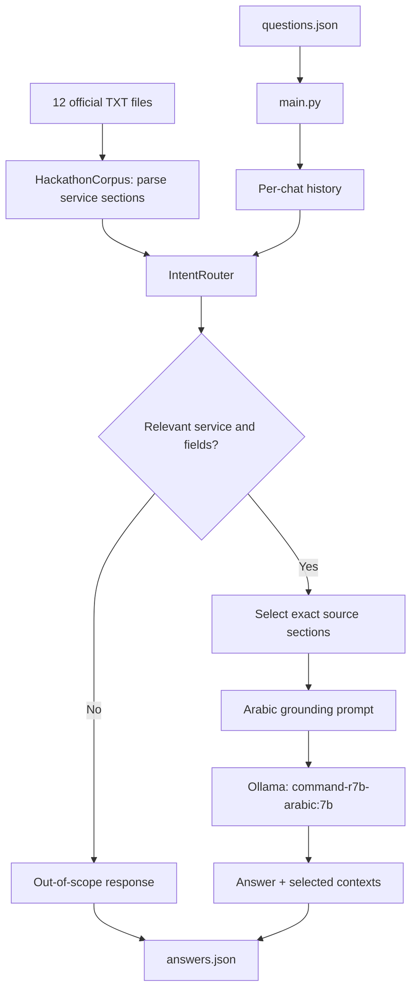

# Jordan Government Services Chatbot 🇯🇴

### 42 Irbid · AI Future 26 · Youth Edition — Government Services Challenge

An **offline Arabic-language government services chatbot** built for the 42 Irbid AI Future 26 hackathon. It answers citizens' questions about Jordanian **passports, family books, and smart ID cards** using the **12 supplied service documents** as its factual source and a locally hosted **Ollama 7B language model** for answer generation.

This hackathon solution lives in the [`hackathon-ollama` branch](https://github.com/Ammar-KDR/hybrid-rag-engine/tree/hackathon-ollama) of the Hybrid RAG Engine repository. Unlike the repository's broader hybrid-retrieval application, the hackathon entry point uses a focused **Arabic intent router and section-based evidence selection** designed for this small, highly structured corpus.

> **Scope:** The chatbot provides document-grounded information, not official legal advice or live government-system access. Answers reflect the supplied challenge documents rather than automatically updated regulations.

## Table of contents

- [Challenge and scope](#challenge-and-scope)
- [Architecture](#architecture)
- [Implementation](#implementation)
- [Repository layout](#repository-layout)
- [Setup](#setup)
- [Running the evaluator](#running-the-evaluator)
- [Input and output](#input-and-output)
- [Example questions](#example-questions)
- [Evaluation and safeguards](#evaluation-and-safeguards)
- [Limitations](#limitations)
- [License](#license)

## Challenge and scope

The challenge is to answer practical citizen questions **correctly and only from official source documents**, including:

- Fees that vary by circumstance
- Required documents and eligibility conditions
- Application offices, processing times, and procedures
- Exceptions embedded in notes
- Jordanian Arabic dialect and informal terminology
- Comparisons involving two services
- Follow-up questions in the same conversation
- Ambiguous questions and topics outside the corpus

The dataset contains **three document categories × four service situations = 12 services**:

| Category | First issue | Renewal | Lost | Damaged |
|---|---|---|---|---|
| Passport (جواز السفر) | `passport_first_issue.txt` | `passport_renewal.txt` | `passport_lost.txt` | `passport_damaged.txt` |
| Family book (دفتر العائلة) | `family_book_first_issue.txt` | `family_book_renewal.txt` | `family_book_lost.txt` | `family_book_damaged.txt` |
| Smart ID (البطاقة الذكية) | `id_card_first_issue.txt` | `id_card_renewal.txt` | `id_card_lost.txt` | `id_card_damaged.txt` |

The `.txt` documents are stored in `data/`. Each service contains fields for beneficiaries, application locations, conditions, required documents, procedures, processing time, partner agencies, notes, and fees.

## Architecture



**Why this architecture?** The 12 services have nearly identical wording, so selecting the correct *document type + situation + field* is particularly important. A compact, section-based workflow avoids sending all 12 documents to the language model for every question.

## Implementation

### 1. Corpus parsing — `src/hackathon/corpus.py`

`HackathonCorpus` registers the 12 services and loads their UTF-8 text. It removes page-navigation text before the first service field and extracts named sections. The resulting evidence strings retain their source identity:

```text
تجديد دفتر العائلة - الزمن المستغرق لتقديم الخدمة: 45 دقيقة
```

These are the `contexts` returned with each generated answer. The corpus parser does **not** use a vector database in this hackathon path.

### 2. Arabic routing — `src/hackathon/router.py`

`IntentRouter` classifies questions by:

1. **Document** — passport, family book, or smart ID.
2. **Situation** — first issue, renewal, replacement for loss, or replacement for damage.
3. **Information field** — fees, documents, conditions, locations, processing time, or notes.
4. **Conversation context** — earlier questions within the same chat when needed.

It uses Arabic normalization, keyword and phrase rules, colloquial synonyms (such as `باسبور`, `هوية`, and `عيلة`), and special handling for some cross-document comparisons. It also detects a set of out-of-scope topics.

### 3. Grounded generation — `src/hackathon/engine.py`

`HackathonEngine` retrieves the chosen service sections, inserts them into an Arabic prompt, and calls Ollama's local `/api/generate` endpoint. The committed engine defaults to:

| Parameter | Value |
|---|---|
| Model | `command-r7b-arabic:7b` |
| Ollama URL | `http://127.0.0.1:11434` |
| Temperature | `0.05` |
| Top-p | `0.85` |
| Context window (`num_ctx`) | `4096` |
| Maximum generated tokens (`num_predict`) | `250` |
| API streaming | Disabled |

The prompt instructs the model to answer briefly in Arabic, avoid unsupported facts, and rely only on the selected evidence. The engine removes certain response prefixes and reasoning tags from model output.

**Important:** The current implementation can automatically choose another locally installed Ollama model if the requested model is missing. For strict hackathon compliance, ensure the required model is installed and selected before evaluation.

### 4. Evaluation entry point — `main.py`

The entry point:

- Reads chats and messages in order from the input JSON.
- Creates a fresh conversation history for each new `chat_id`.
- Passes each question and the current chat history to the engine.
- Captures an `answer` and supporting `contexts` for each message.
- Writes UTF-8 `answers.json` and preserves the original message identifiers and questions.
- Catches individual message exceptions so one failure does not stop the complete batch.

## Repository layout

```text
hybrid-rag-engine/
├── main.py                         # Hackathon evaluator entry point
├── questions.json                  # Practice input
├── answers.json                    # Generated practice output
├── data/
│   ├── passport_*.txt              # Four passport services
│   ├── family_book_*.txt           # Four family-book services
│   ├── id_card_*.txt               # Four smart-ID services
│   ├── hackathon/                  # Additional local evaluation assets
│   └── evaluation/                 # Broader RAG evaluation assets
├── src/
│   ├── hackathon/
│   │   ├── corpus.py               # Document loader and section parser
│   │   ├── router.py               # Arabic intent routing
│   │   └── engine.py               # Ollama answer generation
│   └── rag/                        # General-purpose RAG codebase
├── requirements.txt
├── requirements.lock.txt
├── .env.example
└── README.md
```

The `src/rag/` application, Docker Compose files, Streamlit interface, and the repository's wider RAG benchmarks are separate from the **`python main.py questions.json`** hackathon execution path.

## Setup

### Requirements

- Python 3 with `pip`
- Git
- [Ollama](https://ollama.com/) installed and available locally
- Sufficient RAM/VRAM and disk capacity for a 7B model
- All Python dependencies and model weights installed **before** disconnecting the internet

### 1. Clone the hackathon branch

```bash
git clone --branch hackathon-ollama https://github.com/Ammar-KDR/hybrid-rag-engine.git
cd hybrid-rag-engine
```

### 2. Create a virtual environment

**Windows PowerShell:**

```powershell
py -m venv .venv
.\.venv\Scripts\Activate.ps1
python -m pip install -r requirements.txt
```

**Linux / macOS:**

```bash
python3 -m venv .venv
source .venv/bin/activate
python -m pip install -r requirements.txt
```

`requirements.txt` belongs to the larger repository, so it includes packages that are not directly used in the hackathon entry point.

### 3. Download and start the model

While internet access is still available:

```bash
ollama pull command-r7b-arabic:7b
```

Start Ollama if it is not already running:

```bash
ollama serve
```

Run `ollama serve` in a separate terminal; depending on how Ollama was installed, its background service may already be active. Check the local model installation with:

```bash
ollama list
```

> **Configuration caveat:** `.env.example` currently shows `OLLAMA_MODEL=qwen2.5:3b`, but the hackathon `HackathonEngine` explicitly defaults to `command-r7b-arabic:7b` and `http://127.0.0.1:11434`. The hackathon engine does not currently read those `.env` model settings. Use the required 7B model and verify the model actually selected by the engine.

## Running the evaluator

Place the challenge `questions.json` beside `main.py` and run:

```bash
python main.py questions.json
```

On success, the script writes:

```text
answers.json
```

The output is written beside the supplied input file and is also mirrored to the current working directory when those paths differ. **For judging, run the command from the repository root with `questions.json` in that directory.**

Validate that the result contains one answer per input message:

```bash
python -c "import json; q=json.load(open('questions.json',encoding='utf-8')); a=json.load(open('answers.json',encoding='utf-8')); print('Input messages:',sum(len(c['messages']) for c in q['chats'])); print('Output messages:',sum(len(c['messages']) for c in a['chats']))"
```

**Offline rehearsal:** Install everything, start Ollama, disable Wi-Fi, execute the exact judging command, and confirm that the generated JSON is valid. No external AI service should be needed for the hackathon entry point.

## Input and output

### Input — `questions.json`

The challenge supplies an object containing `chats`. Each chat has a `chat_id` and ordered `messages`; each message contains `message_id` and `question`:

```json
{
  "chats": [
    {
      "chat_id": "chat-01",
      "messages": [
        {
          "message_id": "chat-01-1",
          "question": "كم يستغرق تجديد دفتر العائلة؟"
        }
      ]
    }
  ]
}
```

### Output — `answers.json`

Every input message receives two extra fields: `answer` (Arabic response) and `contexts` (source snippets used to support it):

```json
{
  "chats": [
    {
      "chat_id": "chat-01",
      "messages": [
        {
          "message_id": "chat-01-1",
          "question": "كم يستغرق تجديد دفتر العائلة؟",
          "answer": "يستغرق تجديد دفتر العائلة 45 دقيقة.",
          "contexts": [
            "تجديد دفتر العائلة - الزمن المستغرق لتقديم الخدمة: 45 دقيقة"
          ]
        }
      ]
    }
  ]
}
```

The example above illustrates the **reference format and expected factual response** from the provided sample answer file; it does not claim a verified live model run.

**Formatting requirements:**

- Keep `chats`, `chat_id`, `messages`, `message_id`, and `question` unchanged.
- Add an `answer` string and a `contexts` list to **every** message.
- Return only relevant source excerpts, not whole source files or invented citations.
- Use `[]` for `contexts` when the question is outside the available documents.
- Preserve chat/message order and write **valid UTF-8 JSON**.
- Never leak conversation memory from one chat into another.

## Example questions

| Case | Arabic example | Expected behavior |
|---|---|---|
| Simple fact | `كم يستغرق تجديد دفتر العائلة؟` | Return the duration from the renewal document. |
| Locations | `وين بقدر أطلع جواز سفر بدل فاقد؟` | Use the lost-passport service locations. |
| Required documents | `شو الأوراق المطلوبة لتجديد دفتر العائلة؟` | List the required documents from the correct service. |
| Follow-up | `وبقدر أقدّم الطلب من السفارة إذا كنت برا البلد؟` | Resolve the reference using earlier messages in that chat. |
| Comparison | `قديش صورة شخصية بحتاج للبطاقة الذكية لأول مرة، وقديش لتجديد جواز السفر؟` | Retrieve relevant evidence from both services. |
| Out of scope | `كم سعر تذكرة الطيران من عمان إلى دبي؟` | Politely decline; no airline prices are in the corpus. |

Practice `questions.json` contains **5 chats and 6 messages**, including a two-message conversation. The supplied `answers_example.json` provides reference answers; answer wording may differ if facts and supporting contexts are correct.

## Evaluation and safeguards

According to the challenge brief, assessment emphasizes:

1. **Answer correctness:** Correct fees, requirements, and conditions for the stated situation; appropriate clarification or refusal.
2. **Right source:** Evidence from the correct official service(s).
3. **Grounded generation:** All factual claims supported by the returned `contexts`.

The evaluator also includes dialect questions, comparisons, lengthy questions, misleading assumptions, and conversation follow-ups. Every response must be **generated by the provided local model at runtime**, and the 12 challenge documents must be the only factual source.

The implementation is designed to reduce hallucinations through constrained service routing, section-specific evidence, a strict Arabic system-style prompt, and low-temperature generation. **These are mitigations, not guarantees:** routing errors, missing conditions, and unsupported model output are still possible.

### An important compliance issue to fix before judging

The committed `engine.py` contains `_generate_heuristic_fallback`, which returns extracted context text directly if the Ollama call fails. Although this helps keep a result available, it **does not meet the challenge rule** requiring every answer to be generated by the provided model at runtime. The model-selection fallback can also choose a model other than the required 7B model. Before submission, remove or disable non-model answer fallback and enforce the required model; handle generation failures without substituting a prewritten factual answer.

Likewise, the router currently defaults some ambiguous questions to **passport renewal** rather than asking for clarification. The brief explicitly rewards clarifying unclear questions, so this is another worthwhile improvement.

### Testing

Use the provided practice input and reference answers as a structural and factual sanity check:

```bash
python main.py questions.json
```

Confirm the output structure, message count, service matching, factual accuracy, and context grounding. Avoid presenting unrelated broad-RAG benchmark results as scores on this specific 12-document hackathon challenge.

## Limitations

- Keyword/rule-based routing can misclassify unusual phrasing or complex multi-service questions.
- Some ambiguous questions currently receive a default service rather than a clarification question.
- The generation step is dependent on the Ollama process and sufficient local hardware resources.
- The existing model-selection and non-LLM fallback behavior should be tightened for strict challenge compliance.
- There is no independent post-generation fact verification in this hackathon entry point.
- Results have not been independently validated here by executing Ollama against the practice dataset.

## License

The repository includes an Apache License 2.0 `LICENSE` file. See that file for the complete terms.

---

**Challenge:** 42 Irbid · AI Future 26 · Youth Edition  
**Project:** Jordan Government Services Chatbot  
**Branch:** [`hackathon-ollama`](https://github.com/Ammar-KDR/hybrid-rag-engine/tree/hackathon-ollama)
