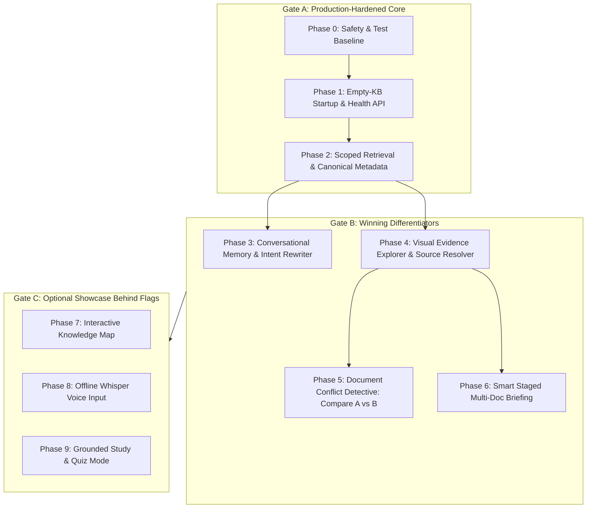
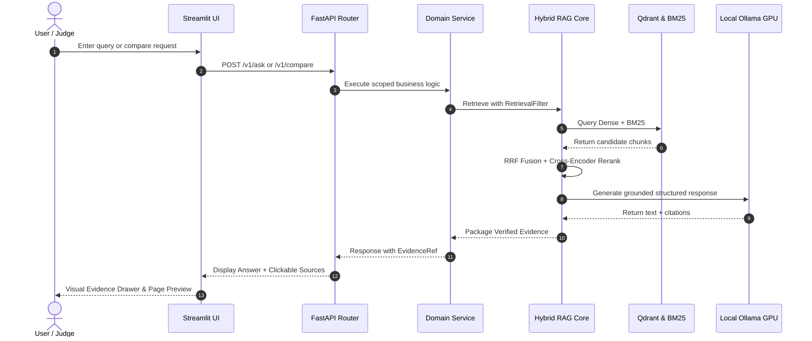

# 🏛️ 42 Irbid Hackathon AI Assistant — Master Implementation Plan

**Project:** `PSUT Sovereign Hybrid RAG — Document Detective`  
**Repository:** `Ammar-KDR/hybrid-rag-engine`  
**Target Event:** 42 Irbid AI Hackathon (October 15, 2026 • 4-Hour Competition)  
**Target Machine:** 16 GB RAM • NVIDIA GeForce RTX 3060 Laptop GPU (6 GB VRAM, CUDA 8.6)  
**LLM Engine:** Local `qwen2.5:3b` via Ollama (`http://localhost:11434/v1`) with `keep_alive: -1`  
**Vector Store:** Embedded Qdrant (`data/qdrant_storage`), zero Docker dependency  
**UI Theme:** Princess Sumaya University for Technology (PSUT) White & Royal Navy Blue  
**Current Branch:** `hackathon-ollama`  

---

## 1. Executive Summary & Core Demo Message

Most hackathon teams will construct a standard, single-turn RAG pipeline that answers basic questions.  
Our competitive differentiator is the **Local AI Document Detective**:

> *"Most document assistants give an answer and ask you to trust it. The Document Detective lets judges investigate the answer, inspect exact evidence down to the original page, resolve conversations naturally, and discover when policies or documents disagree — all 100% locally on a single laptop without cloud exfiltration."*

### Feature Gates Hierarchy



---

## 2. Current State vs. Plan Gap Analysis

| Component / Feature | Initial Repo State | Current Actual State | Target State in This Plan |
| :--- | :--- | :--- | :--- |
| **LLM Backend** | LM Studio / Gemini API | **Ollama (`qwen2.5:3b`) locked in GPU VRAM** | Provider-neutral configuration with healthchecks |
| **Vector Database** | Requires Docker Desktop | **Embedded local Qdrant (`data/qdrant_storage`)** | Verified zero-Docker embedded storage |
| **Document Ingestion** | Flat MD/PDF/TXT scan | **Recursive scan + Word `.docx` support** | Robust bulk upload + empty-KB startup |
| **Verification Latency** | 45s sequential verification | **Fast-path toggle (`ENABLE_VERIFICATION=false`)** | Dual-mode: `FAST` (<3s) vs `FULL` (<30s) |
| **Citation Attribution** | Brittle regex, dropped citations | **Multi-format regex + guaranteed fallback** | Standardized `EvidenceRef` contract |
| **Upload Security** | `print(content)` in route | `print(content)` still present | **Removed immediately (Phase 0)** |
| **Empty KB Startup** | Crashes on startup | Crashes if `chunks.jsonl` absent | **Empty-safe BM25 & graceful fallback (Phase 1)** |
| **Health API** | Missing | Missing | **`GET /v1/health` diagnostic endpoint (Phase 1)** |
| **Scoped Retrieval** | Filter ignored by BM25 | Filter ignored by BM25 | **`RetrievalFilter` across Dense + BM25 (Phase 2)** |
| **Conversational Memory** | Single-turn only | Single-turn only | **Heuristic/LLM Query Rewriter (Phase 3)** |
| **Evidence Explorer** | Text citations only | Text citations only | **Safe source download & page preview (Phase 4)** |
| **Document Comparison** | Missing | Missing | **`POST /v1/compare` Conflict Detective (Phase 5)** |
| **Executive Briefing** | Basic UI export | Basic UI export | **`POST /v1/brief` Map-Reduce Service (Phase 6)** |
| **UI Aesthetics** | Default dark Streamlit | **PSUT White & Royal Navy with logo** | Multi-tab institutional dashboard (Phase 10) |

---

## 3. Non-Negotiable Architectural Principles

1. **Frozen Core Retrieval**: Do not replace or retune Dense retrieval, BM25, RRF fusion, or BGE Cross-Encoder reranking. Build modular services *around* them.
2. **Untrusted Evidence**: Document text is strictly treated as untrusted data. Prompts must explicitly instruct the model never to treat document passages as executable instructions.
3. **No Hallucinated Memory**: Chat history is used exclusively to clarify ambiguous pronouns/follow-up intent. Past model answers are **never** treated as factual evidence for retrieval.
4. **Conservative Classification**: In comparison mode, never label differences as "contradictions" if effective dates or jurisdictions explain them. Use `scope_or_version_difference`.
5. **Safe Source Resolution**: Never accept arbitrary filesystem paths from clients. All source accesses must be resolved server-side through `document_id` and verified to remain within `settings.DATA_PATH`.
6. **Graceful Degradation**: Optional features (Voice, Knowledge Map, Quiz) must live behind feature flags and must never prevent core chat from functioning.

---

## 4. Phase-by-Phase Technical Specifications



---

### Phase 0: Safety Baseline & Hygiene

- [ ] **Task 0.1**: Remove `print(content)` from `src/rag/api/routes/ingest.py` (line 39) to eliminate raw byte dumping.
- [ ] **Task 0.2**: Create `docs/hackathon/baseline.md` documenting current test suite status and response schema.
- [ ] **Task 0.3**: Verify existing test suite passes 100% (`pytest tests/`).

**Acceptance Criteria:**
- Zero document bytes printed to stdout/stderr.
- Full test suite green.
- Baseline document committed.

---

### Phase 1: Robust Startup & Health Diagnostics

- [ ] **Task 1.1: Empty Knowledge Base Startup**:
  - Update `src/rag/retrieval/bm25.py`: If `chunks.jsonl` is missing or contains 0 chunks, initialize an empty-safe BM25 index that returns `[]` without error.
  - Update `src/rag/factory.py`: Allow application startup when vector store or chunk store contains zero documents.
  - Update `src/rag/pipeline.py`: If retrieval returns 0 candidates, return an immediate, controlled abstention response: *"The knowledge base is currently empty or contains no relevant documents."*
- [ ] **Task 1.2: System Health Endpoint (`GET /v1/health`)**:
  - Create `src/rag/api/routes/health.py` and register in `src/rag/api/app.py`.
  - Return JSON schema:
    ```json
    {
      "status": "ready",
      "offline_mode": true,
      "ollama": {"ready": true, "model": "qwen2.5:3b"},
      "qdrant": {"ready": true, "mode": "embedded"},
      "embedding_model": {"ready": true, "name": "all-MiniLM-L6-v2"},
      "reranker": {"ready": true, "name": "bge-reranker-base"},
      "document_count": 26,
      "chunk_count": 268
    }
    ```
- [ ] **Task 1.3: Offline Preflight CLI (`scripts/preflight_offline.py`)**:
  - Add standalone script verifying Ollama connectivity, model presence, GPU VRAM caching, and embedded storage accessibility with zero internet access.

**Acceptance Criteria:**
- API and UI start cleanly from an empty data directory.
- `GET /v1/health` returns status code `200` with full component status.

---

### Phase 2: Scoped Retrieval & Canonical Metadata

- [ ] **Task 2.1: Canonical Metadata Schema**:
  - Ensure every chunk in `ChunkStore` and Qdrant payload stores:
    - `document_id` (SHA-256 string)
    - `filename` (clean display name, e.g. `policy_2026.pdf`)
    - `source` (relative path)
    - `file_type` (`pdf`, `docx`, `md`, `txt`, `html`)
    - `page_number` (`int | None`)
    - `heading_path` (`list[str] | None`)
    - `chunk_index` (`int`)
- [ ] **Task 2.2: Scoped Retrieval Filter**:
  - Create `RetrievalFilter` domain model in `src/rag/retrieval/model.py`:
    ```python
    @dataclass(frozen=True)
    class RetrievalFilter:
        document_ids: tuple[str, ...] = ()
    ```
  - Update `DenseRetriever`: Map `document_ids` to Qdrant `models.Filter(must=[models.FieldCondition(key="document_id", match=models.MatchAny(any=list(document_ids)))])`.
  - Update `BM25Retriever`: Filter eligible chunk indices **before** ranking so irrelevant documents do not displace target documents.
  - Update `HybridRetriever`: Forward the filter to both branches and fuse filtered results via RRF.

**Acceptance Criteria:**
- Querying with `RetrievalFilter(document_ids=("doc_a",))` retrieves chunks strictly from `doc_a`.
- Dense and BM25 filters produce 100% agreement on document scoping.

---

### Phase 3: Conversational Memory & Intent Rewriting

- [ ] **Task 3.1: Conversational Request Contract**:
  - Extend `AskRequest` in `src/rag/api/schemas/ask.py`:
    ```python
    class ChatMessage(BaseModel):
        role: Literal["user", "assistant"]
        content: str

    class AskRequest(BaseModel):
        question: str
        include_trace: bool = False
        history: list[ChatMessage] = []
        document_ids: list[str] | None = None
        verification_mode: Literal["fast", "full"] = "fast"
    ```
  - Extend `AskResponse`: Include `original_question`, `retrieval_question`, and `was_rewritten: bool`.
- [ ] **Task 3.2: Heuristic/LLM Query Rewriter Service**:
  - Create `src/rag/conversation/rewriter.py`.
  - Heuristic trigger: Only invoke rewriting if the question contains pronouns (*it*, *they*, *that*, *this*), elliptical phrasing (*what about...*, *are there exceptions?*), or is under 5 words.
  - If standalone: return original question with `was_rewritten = False` (zero latency penalty).
  - If follow-up: use local Ollama to rewrite into a standalone query using the last 2 conversation turns.
  - **Safety constraint**: Never use assistant replies as factual truth; only use them to resolve the referent subject.

**Acceptance Criteria:**
- *"What is the refund deadline?"* $\rightarrow$ Answered normally (`was_rewritten = False`).
- Follow-up: *"Are there exceptions to it?"* $\rightarrow$ Rewritten to *"Are there exceptions to the refund deadline?"* (`was_rewritten = True`).
- Retrieval searches fresh document evidence for the rewritten query.

---

### Phase 4: Visual Evidence Explorer & Safe Source Access

- [ ] **Task 4.1: Standardized EvidenceRef Contract**:
  - Create `EvidenceRef` in `src/rag/api/schemas/ask.py` and `src/rag/generation/model.py`:
    ```python
    class EvidenceRef(BaseModel):
        reference: int
        chunk_id: str
        document_id: str
        filename: str
        source: str
        file_type: str | None = None
        page_number: int | None = None
        heading_path: list[str] | None = None
        text: str
        final_score: float | None = None
    ```
  - Include full list of cited and retrieved evidence blocks in `AskResponse.evidence`.
- [ ] **Task 4.2: Safe Document Resolver & Page Preview Routes**:
  - Create `src/rag/api/routes/source.py`:
    - `GET /v1/documents/{document_id}/source`: Safely streams document bytes verifying that the resolved path is strictly within `settings.DATA_PATH` (rejecting `../` traversal).
    - `GET /v1/documents/{document_id}/pages/{page_number}/preview`: Renders the requested PDF page as a PNG image using `PyMuPDF` (`fitz`).
- [ ] **Task 4.3: UI Evidence Drawer Component**:
  - When a judge clicks a citation badge (e.g. `[1]`), open an interactive Evidence Drawer displaying:
    - Clean filename and section path.
    - Full verbatim text chunk.
    - PDF page preview image side-by-side with the text.

**Acceptance Criteria:**
- Clicking any citation opens the exact raw text snippet and rendered PDF page.
- Path traversal attacks (`/v1/documents/../../etc/passwd/source`) return `403 Forbidden`.

---

### Phase 5: Document Conflict Detective (Star Demo Feature)

- [ ] **Task 5.1: Conflict API Schemas (`POST /v1/compare`)**:
  - Create `src/rag/api/schemas/compare.py`:
    ```python
    class CompareRequest(BaseModel):
        document_a_id: str
        document_b_id: str
        topic: str
        verification_mode: Literal["fast", "full"] = "fast"

    class ComparisonRelationship(str, Enum):
        AGREEMENT = "agreement"
        POSSIBLE_CONFLICT = "possible_conflict"
        SCOPE_OR_VERSION_DIFFERENCE = "scope_or_version_difference"
        INSUFFICIENT_EVIDENCE = "insufficient_evidence"

    class DocumentClaim(BaseModel):
        document_id: str
        filename: str
        claim: str
        evidence: list[EvidenceRef]
        scope_notes: str | None = None

    class CompareResponse(BaseModel):
        topic: str
        relationship: ComparisonRelationship
        summary: str
        document_a: DocumentClaim
        document_b: DocumentClaim
        resolution_notes: str
        confidence: Literal["high", "medium", "low"]
    ```
- [ ] **Task 5.2: Comparison Service (`src/rag/comparison/service.py`)**:
  - Step 1: Scoped retrieval on Document A for `topic`.
  - Step 2: Scoped retrieval on Document B for `topic`.
  - Step 3: If either document has insufficient evidence, return `INSUFFICIENT_EVIDENCE`.
  - Step 4: Structured comparison prompt to Ollama enforcing strict evidence isolation (Doc A claims only cite Doc A evidence; Doc B claims only cite Doc B evidence).
  - Step 5: Conservative classification: If effective dates or applicability differ, classify as `SCOPE_OR_VERSION_DIFFERENCE` rather than blind conflict.
- [ ] **Task 5.3: UI Dual-Card Comparison View**:
  - Side-by-side cards for Document A vs Document B.
  - Large relationship status badge (Green for Agreement, Blue for Version Difference, Amber for Possible Conflict).

**Acceptance Criteria:**
- Comparing a 2025 policy (30 days) vs 2026 policy (14 days with effective date) accurately returns `scope_or_version_difference`.
- Neither document cross-contaminates evidence references.

---

### Phase 6: Smart Staged Multi-Document Briefing

- [ ] **Task 6.1: Briefing Contract (`POST /v1/brief`)**:
  - Create `src/rag/api/schemas/brief.py`:
    ```python
    class BriefRequest(BaseModel):
        document_ids: list[str]
        focus: str = "Executive Summary, Critical Policies, and Key Dates"
        max_findings: int = 8
        verification_mode: Literal["fast", "full"] = "fast"

    class BriefFinding(BaseModel):
        title: str
        description: str
        category: Literal["policy", "technical", "compliance", "action_item"]
        evidence: list[EvidenceRef]

    class BriefResponse(BaseModel):
        focus: str
        executive_summary: str
        findings: list[BriefFinding]
        important_dates_and_metrics: list[str]
        unanswered_questions: list[str]
        generated_at: str
    ```
- [ ] **Task 6.2: Map-Reduce Briefing Service**:
  - Bounded batch mapping: Process chunks across selected documents in bounded token windows.
  - Deduplication: Merge overlapping findings while preserving citation links.
  - Reduce: Synthesize into high-level executive report with verified citations.
- [ ] **Task 6.3: UI Briefing Tab**:
  - Document multi-selector $\rightarrow$ Generate Briefing button $\rightarrow$ Structured executive cards $\rightarrow$ 1-Click Markdown Download.

**Acceptance Criteria:**
- Selecting 3 documents produces a multi-section briefing with every factual bullet linked to its original source chunk.

---

### Phase 7–9: Showcase Features (Gate C Behind Flags)

- [ ] **Phase 7: Interactive Knowledge Map (`POST /v1/knowledge-map`)**:
  - Extract entity/concept relationships from retrieved evidence.
  - Render offline interactive graph using Plotly / NetworkX.
- [ ] **Phase 8: Offline Voice Input (`POST /v1/transcribe`)**:
  - Local speech-to-text using `faster-whisper` (`tiny` model, int8 CPU).
  - Audio transcribed locally into the chat input area for user review before submission.
- [ ] **Phase 9: Grounded Quiz & Study Mode (`POST /v1/quiz`)**:
  - Generate 5 multiple-choice questions grounded in selected document chunks with evidence reveals.

---

### Phase 10: Multi-Tab UI & 3-Minute Live Demo Pitch

- [ ] **Task 10.1: Multi-Tab Product Architecture**:
  - Tab 1: **🔍 Interactive Chat & Evidence** (Multi-turn conversation, source pills, visual evidence drawer).
  - Tab 2: **⚖️ Document Conflict Detective** (Side-by-side comparison between two policies/docs).
  - Tab 3: **📋 Executive Briefings** (Multi-document synthesis & report download).
  - Tab 4: **📁 Knowledge Repository** (Bulk upload, document catalog, indexing stats).
- [ ] **Task 10.2: 3-Minute Live Demo Pitch Flow**:
  1. *Minute 1 (Core Q&A)*: Ask *"What is the refund deadline in the current policy?"* $\rightarrow$ Click citation $\rightarrow$ Show exact passage and rendered PDF page.
  2. *Minute 2 (Conflict Detective)*: Select `2025_Policy.pdf` vs `2026_Policy.pdf` on topic *"Refund Deadline"* $\rightarrow$ System flags `Scope/Version Difference` with effective dates.
  3. *Minute 3 (Executive Briefing & Sovereignty)*: Generate 1-click briefing $\rightarrow$ Highlight that entire system (embeddings, vector store, reranker, and LLM) ran 100% locally with zero cloud data exfiltration.

---

## 5. Verification & Testing Matrix

```text
tests/
├── unit/
│   ├── test_schemas.py           # Contract validation
│   ├── test_bm25_filter.py       # Scoped BM25 filtering
│   ├── test_qdrant_filter.py     # Scoped Dense filtering
│   ├── test_rewriter.py          # Conversational rewriter triggers
│   ├── test_compare_service.py   # Conflict classification logic
│   └── test_briefing_service.py  # Map-reduce deduplication
├── api/
│   ├── test_ask.py               # Single-turn & multi-turn Q&A
│   ├── test_health.py            # GET /v1/health status
│   ├── test_source.py            # Safe source resolution & preview
│   ├── test_compare.py           # POST /v1/compare endpoint
│   └── test_brief.py             # POST /v1/brief endpoint
└── integration/
    └── test_offline_readiness.py # End-to-end pipeline verification
```

---

## 6. Execution Progress Checklist

- [ ] **Phase 0**: Remove `print(content)`, record baseline tests.
- [ ] **Phase 1**: Empty-KB startup, `GET /v1/health`, offline preflight.
- [ ] **Phase 2**: Canonical metadata & `RetrievalFilter` (Dense + BM25).
- [ ] **Phase 3**: Conversational Memory & Heuristic Query Rewriter.
- [ ] **Phase 4**: Visual Evidence Explorer & Safe Source Resolver.
- [ ] **Phase 5**: Document Conflict Detective (`POST /v1/compare`).
- [ ] **Phase 6**: Smart Staged Multi-Document Briefing (`POST /v1/brief`).
- [ ] **Phase 10**: Streamlit Multi-Tab UI Integration & Demo Polish.
